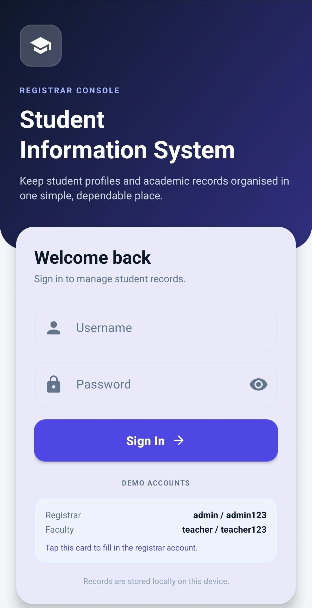
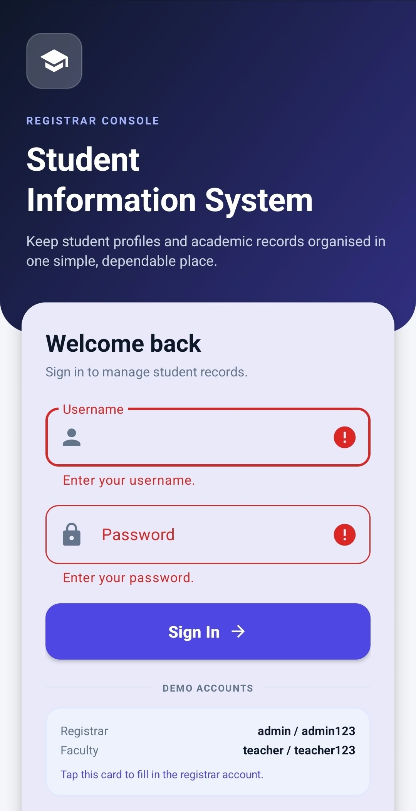
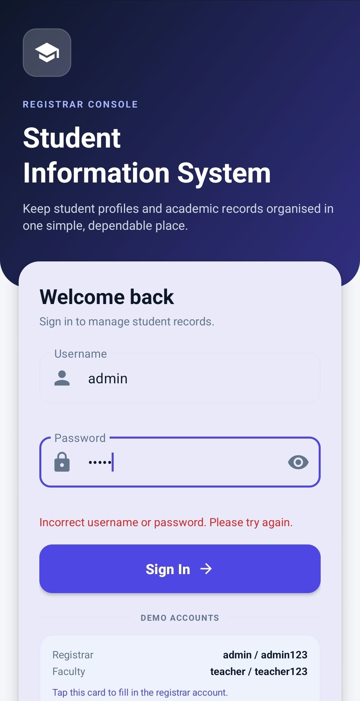
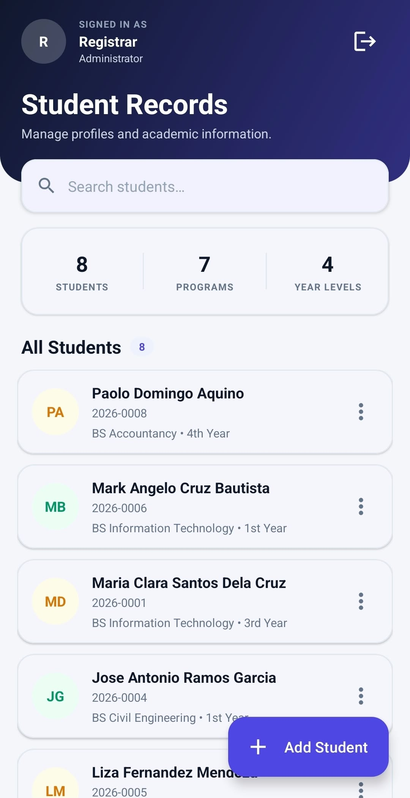
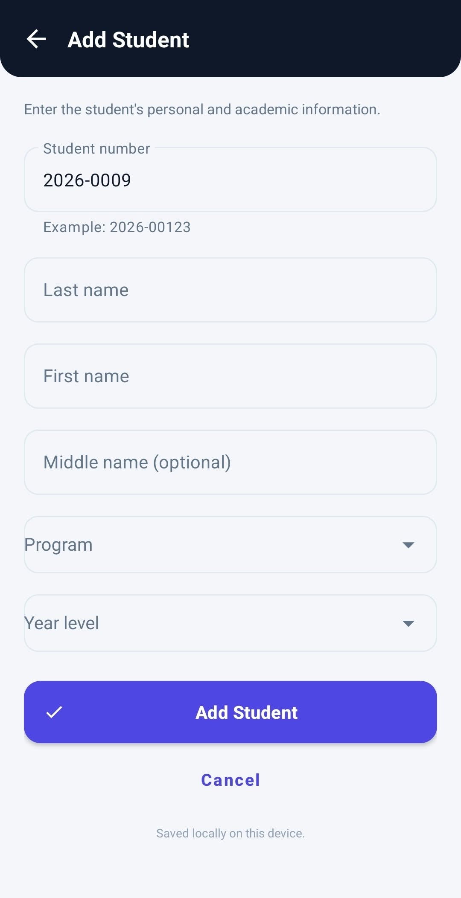

# Student Information System — Android (Java)

A native Android application for the **Application Development Laboratory**.
It is written in **Java**, uses **SQLite** for local data, and is designed to be
demonstrated on a **real Android phone** — no Android Studio emulator required.

The APK is already built here:

```
dist/StudentInformationSystem-debug.apk
```

---

## Screenshots

| Login | Validation |
| :---: | :---: |
|  |  |

| Invalid credentials | Records dashboard | Add student |
| :---: | :---: | :---: |
|  |  |  |

---

## 1. Features

### Login
- Username and password authentication
- Field validation and a clear error message for invalid credentials
- Show/hide password toggle
- Tap-to-fill demo account card (for classroom demonstrations)
- Logout with confirmation

### Student information
- Student number (required and unique)
- Last name, first name, middle name
- Add, edit, and delete student records
- Confirmation before deleting a record
- Duplicate student numbers are rejected

### Academic information
- Program selection (BS IT, BS Computer Science, BS Information Systems, etc.)
- Year level selection (1st–5th Year)

### Records dashboard
- Live totals: students, programs, and year levels
- Search by student number, name, program, or year level
- Pull-free local SQLite storage: data remains after closing the app
- Empty-state guidance when there are no records or no search results
- Sample records are seeded on first install so the app is demo-ready

---

## 2. Demo accounts

| Role | Username | Password |
| :--- | :--- | :--- |
| Registrar | `admin` | `admin123` |
| Faculty | `teacher` | `teacher123` |

The credentials are intentionally visible on the login screen and are
hard-coded for this laboratory exercise. This is **not** production
authentication.

---

## 3. Run it on your own phone (recommended)

Your phone is not an emulator — it is a real Android device. This is the
lightest and most reliable demonstration option.

### Option A — Install the APK directly (no laptop needed)

1. Copy `dist/StudentInformationSystem-debug.apk` to your phone using USB,
   Google Drive, Bluetooth, or any file-transfer method.
2. On the phone, open the APK from **Files**.
3. If prompted, allow **Install unknown apps** for the file manager.
4. Tap **Install**, then open **Student SIS**.

The app requires **Android 7.0 (API 24) or newer**.

### Option B — USB debugging + Android Studio (recommended for development)

1. On the phone: **Settings → About phone**, tap **Build number** seven times.
2. Open **Developer options** and enable **USB debugging**.
3. Connect the phone by USB and choose **File transfer** on the phone.
4. Accept the **Allow USB debugging** prompt.
5. In Android Studio, the phone appears in the device dropdown as a physical
   device (for example, `Pixel 7` or `SM-A125F`). Select it and press **Run**.
   Android Studio installs and launches the app on the phone.

No AVD/emulator is created or started.

### Option C — Command line install

With the phone connected and USB debugging enabled, double-click:

```
install-apk.bat
```

or run:

```bat
adb install -r dist/StudentInformationSystem-debug.apk
adb shell am start -n com.example.sis/.LoginActivity
```

### Show the phone on the projector (optional)

[scrcpy](https://github.com/Genymobile/scrcpy) mirrors the phone screen with
very little CPU/RAM usage. After connecting the phone:

```
mirror-phone.bat
```

or:

```bat
scrcpy --max-size 1024 --max-fps 30 --stay-awake
```

This lets the class see the real app running on a real phone through the
laptop/projector.

---

## 4. Five-minute classroom demo script

1. **Login validation** — press **Sign In** with empty fields to show the
   required-field messages.
2. **Wrong password** — type `admin` / `wrong`, show the error, then tap the
   demo account card to fill `admin` / `admin123`.
3. **Dashboard** — point out the three live statistics and the eight seeded
   student records.
4. **Add a student** — tap **Add Student**, enter:
   - Student number: `2026-0009`
   - Last name: `Abad`
   - First name: `Carla`
   - Middle name: `Mendoza`
   - Program: `BS Information Technology`
   - Year level: `2nd Year`
   Tap **Add Student**. The new record appears near the top of the
   alphabetical list and the totals increase.
5. **Search** — search for `Abad` (or a program such as `Nursing`) to show
   live filtering.
6. **Edit** — tap the new student, change the year level to `3rd Year`, and
   save. Show that the record updates.
7. **Delete** — open the three-dot menu on a record, choose **Delete**, and
   confirm. Show that the total decreases.
8. **Persistence** — fully close the app (remove it from recent apps) and open
   it again. Log in and show that the changes are still there.
9. **Logout** — tap the logout icon and show the return to the login screen.

---

## 5. Build from source

### Requirements
- JDK 17+ (the project was built with Temurin 17)
- Android SDK with compile SDK 37 (the existing Android Studio installation is sufficient)
- Internet access only on the first build, to download Gradle dependencies

### Command line

```bat
gradlew.bat :app:assembleDebug :app:testDebugUnitTest
```

The debug APK is generated at:

```
app/build/outputs/apk/debug/app-debug.apk
```

Or double-click `build-apk.bat`, which also copies the APK to
`dist/StudentInformationSystem-debug.apk`.

### Android Studio
1. **File → Open** the cloned project folder.
2. Let Gradle sync finish.
3. Connect the phone as described in section 3 and press **Run**.

---

## 6. If a phone is not available

These are fallback options only. The physical-phone route above is the
lightest and most reliable.

### A. Low-spec standard Android emulator

Instead of running the heavy default AVD from Android Studio, create a small
AVD with no Google Play services and run it from the command line. This uses
less RAM and no Android Studio window.

```bat
sdkmanager "system-images;android-30;default;x86_64"
avdmanager create avd -n SIS_Low -k "system-images;android-30;default;x86_64" -d pixel_2 --force
emulator -avd SIS_Low -memory 1536 -cores 2 -no-snapshot -no-boot-anim -gpu swiftshader_indirect -no-audio
```

Then install and launch:

```bat
adb install -r dist/StudentInformationSystem-debug.apk
adb shell am start -n com.example.sis/.LoginActivity
```

Notes:
- Hardware virtualization (WHPX/HAXM) should be enabled; without it this may
  be too slow.
- Keep the AVD at 720×1280 or 480×800, 1.5 GB RAM, and no Google APIs.
- Close Android Studio while the emulator is running if memory is tight.

### B. Lightweight third-party emulator

**LDPlayer 9** or **BlueStacks 5** can run the APK with a smaller Android Studio
footprint. Install only from the official vendor website, skip optional
bundled apps, and drag `StudentInformationSystem-debug.apk` into the emulator
window. These are third-party tools and may show ads; they are not required by
this project.

### C. Browser-based demo

[Appetize.io](https://appetize.io) can run an uploaded APK in a browser without
installing an emulator locally. This needs internet access and a free account,
and the free tier has usage limits. Suitable only as a last resort.

---

## 7. Project structure

```
StudentInformationSystem
├── app
│   ├── build.gradle.kts
│   └── src
│       ├── main
│       │   ├── AndroidManifest.xml
│       │   ├── java/com/example/sis
│       │   │   ├── LoginActivity.java
│       │   │   ├── DashboardActivity.java
│       │   │   ├── StudentFormActivity.java
│       │   │   ├── data
│       │   │   │   ├── AuthService.java
│       │   │   │   ├── StudentDbHelper.java
│       │   │   │   └── StudentRepository.java
│       │   │   ├── model/Student.java
│       │   │   └── ui
│       │   │       ├── EdgeToEdge.java
│       │   │       ├── StudentAdapter.java
│       │   │       └── UiUtils.java
│       │   └── res (layouts, drawables, colors, strings, icons)
│       └── test/java/com/example/sis (unit tests)
├── dist/StudentInformationSystem-debug.apk
├── build-apk.bat
├── install-apk.bat
├── mirror-phone.bat
└── README.md
```

---

## 8. Data storage

- Database: `sis.db` in the app's private storage (SQLite).
- Table: `students`, with a unique, case-insensitive student number.
- First launch inserts eight sample students. This makes the dashboard
  demo-ready.
- To reset the demo data: **Settings → Apps → Student SIS → Storage →
  Clear storage**. The next launch re-seeds the sample records.

---

## 9. Technical notes and verification

- Language: **Java** (source/target compatibility 11)
- UI: Android Views + Material Components (Material 3 theme)
- Minimum Android version: **7.0 (API 24)**
- Target/compile SDK: 37
- Package: `com.example.sis`
- Storage: SQLite (`SQLiteOpenHelper`)
- No internet permission is requested; everything works offline
- Edge-to-edge insets are handled for modern Android versions
- The student number is enforced as unique by the database and the form

Verification performed in this project:

- `gradlew.bat :app:assembleDebug` — **successful**
- `gradlew.bat :app:testDebugUnitTest` — **8 tests, all passing**
- `gradlew.bat :app:lintDebug` — **no errors** (warnings only)
- APK packaged and inspected with `aapt2`:
  - package `com.example.sis`
  - minSdk 24
  - targetSdk 37
  - approximately 6.5 MB

The project was built and verified on the development machine. Installing the
APK on the student's own phone is the final classroom step, and no Android
emulator is required for it.
